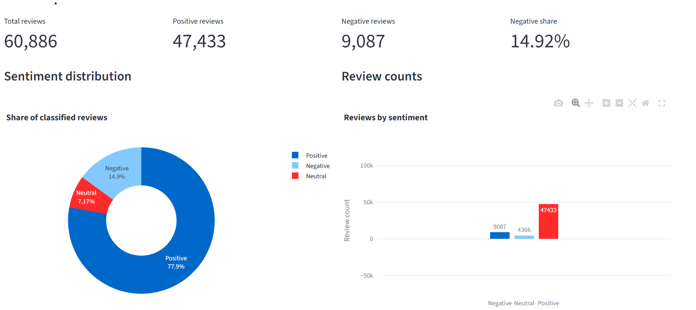
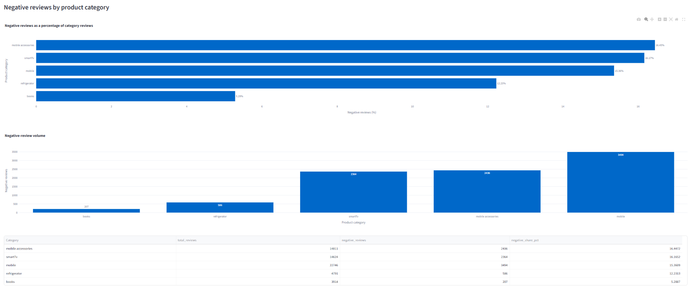
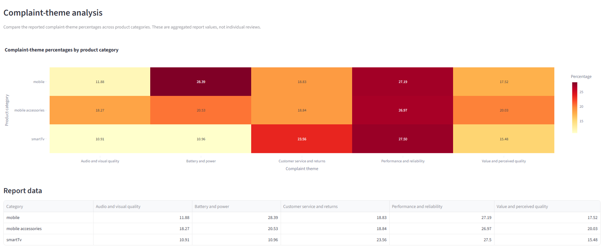
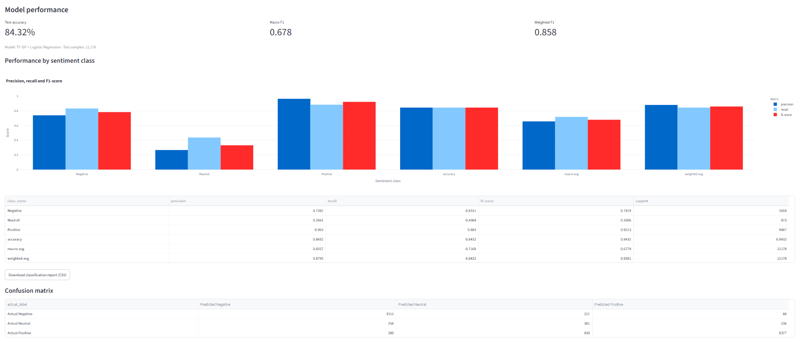

# AI Customer Review Intelligence

An end-to-end customer review analytics project combining natural language processing (NLP), machine learning, SQL analytics, and automated data validation to turn customer feedback into actionable product insights.

## Project Overview

This project analyses customer reviews to understand sentiment, identify recurring complaint themes, and compare customer feedback across product categories. It combines a trained sentiment classification model with structured reporting and SQL queries to support evidence-based product and customer experience decisions.

## Business Objectives

- Clean and prepare customer review data for analysis.
- Classify reviews as positive, negative, or neutral using machine learning.
- Analyse sentiment distribution across product categories.
- Identify recurring themes in negative customer feedback.
- Use SQL to investigate complaint volumes and category-level trends.
- Validate reporting data and analytical results with automated tests.

## Technology Stack

| Area | Technologies |
|---|---|
| Programming | Python |
| Data analysis | Pandas, NumPy |
| NLP and machine learning | Scikit-learn, TF-IDF, Logistic Regression |
| Analytics and storage | SQL, SQLite |
| Visualisation | Matplotlib / exported analysis charts |
| Development environment | Google Colab, Jupyter Notebook |
| Quality assurance | Pytest, automated data validation |
| Version control | Git, GitHub |

## Dataset

The analysis started with 60,889 source records. After cleaning, 60,886 reviews remained.

| Sentiment | Reviews | Share |
|---|---:|---:|
| Positive | 47,433 | 77.90% |
| Negative | 9,087 | 14.92% |
| Neutral | 4,366 | 7.17% |
| **Total** | **60,886** | **100%** |

The repository contains aggregated reports and visualisations rather than the full raw review dataset.

## Machine Learning Approach

The sentiment classification workflow uses:

1. **Data preparation:** clean and validate the review data.
2. **Text representation:** transform review text into numerical features using TF-IDF.
3. **Model training:** train a Logistic Regression classifier.
4. **Evaluation:** assess classification accuracy, precision, recall, F1-score, and the confusion matrix.
5. **Business analysis:** use the resulting reports to examine sentiment and complaint patterns.

### Model Results

| Metric | Result |
|---|---:|
| Test accuracy | 84.32% |
| Macro F1-score | 0.6779 |
| Weighted F1-score | 0.8581 |
| Test samples | 12,178 |

The difference between macro and weighted F1-score indicates that performance varies across sentiment classes. Neutral sentiment is a particular area for improvement, so accuracy alone should not be used to judge model quality.

## Key Business Findings

### Sentiment by product category

| Category | Total reviews | Negative reviews | Negative share |
|---|---:|---:|---:|
| Mobile accessories | 14,811 | 2,436 | 16.45% |
| Smart TVs | 14,624 | 2,364 | 16.17% |
| Mobile | 22,746 | 3,494 | 15.36% |
| Refrigerators | 4,791 | 586 | 12.23% |
| Books | 3,914 | 207 | 5.29% |

**Insights:**

- Mobile accessories have the highest negative-review share at 16.45%, making them a useful priority for further investigation.
- Mobile products contribute the largest absolute volume of negative reviews, with 3,494.
- Books have the lowest negative-review share among the five categories analysed.
- Complaint themes such as performance and reliability, battery and power, and customer service can help guide deeper product-category investigations.

These results indicate where further investigation may be valuable; they do not, by themselves, establish the underlying cause of customer dissatisfaction.

## Interactive Streamlit Dashboard

Explore customer sentiment, product-category performance, complaint themes, and model evaluation through the interactive Streamlit dashboard.

Run locally from the project root:

```bash
python -m streamlit run dashboard/app.py
```

### Dashboard screenshots

**Executive overview**



**Category intelligence**



**Complaint themes**



**Model performance**



---
## SQL Analytics and Reporting

The project includes SQL queries for:

- Overall sentiment distribution.
- Ranking product categories by negative-review share.
- Ranking categories by negative-review volume.
- Reviewing model performance by sentiment class.

Python scripts load the existing CSV and JSON reports into a locally generated SQLite database. The SQL runner executes the saved queries and prints their results.

## Automated Testing and Data Quality

Pytest tests validate key project outputs, including:

- Total review counts and sentiment categories.
- Category totals and negative-review percentages.
- Expected model performance metrics.
- Confusion matrix totals.
- SQLite table creation and reporting query results.

The current test suite contains **8 tests**, covering important analytical and data integrity checks.

## Repository Structure

```text
AI-Customer-Review-Intelligence/
├── notebooks/
│   └── AI_Customer_Review_Intellegence.ipynb
├── reports/
│   ├── category_sentiment_summary.csv
│   ├── classification_report.csv
│   ├── complaint_theme_heatmap_data.csv
│   ├── complaint_theme_heatmap.png
│   ├── confusion_matrix.csv
│   ├── model_metrics.json
│   ├── negative_review_share_by_category.png
│   └── sentiment_distribution.csv
│   └── sentiment_distribution.png
├── sql/
│   ├── 01_sentiment_distribution.sql
│   ├── 02_category_negative_reviews.sql
│   ├── 03_negative_review_volume.sql
│   └── 04_classification_performance.sql
├── src/
│   ├── load_reports.py
│   └── run_sql.py
├── tests/
│   └── test_reports.py
├── data/                 # Generated local database; excluded from Git
├── .gitignore
└── README.md
```

## Run the Project Locally

### 1. Clone the repository

```bash
git clone https://github.com/liki2124/AI-Customer-Review-Intelligence.git
cd AI-Customer-Review-Intelligence
```

### 2. Install dependencies

Python 3.12 was used during local validation.

```bash
python -m venv .venv
```

On Windows PowerShell:

```powershell
.\.venv\Scripts\Activate.ps1
python -m pip install pandas pytest
```

### 3. Generate the local SQLite database

```powershell
python src/load_reports.py
```

This loads the existing reports into `data/customer_reviews.db`. The original raw review dataset is not required for this reporting step.

### 4. Run the SQL analytics

```powershell
python src/run_sql.py
```

### 5. Run automated tests

```powershell
python -m pytest -v
```

Expected result for the current test suite: **8 passed**.

## Limitations and Future Improvements

- Compare additional classification models and tune model parameters.
- Improve neutral-sentiment classification and investigate class-level errors.
- Evaluate performance across product categories.
- Expand the SQL reporting layer with additional business metrics.
- Develop an interactive dashboard.
- Deploy a review analysis API and explore cloud-based deployment and monitoring.

## Author

**Likitha Shivananjegowda**

MSc Computing (Data Analytics), Dublin City University

GitHub: [liki2124](https://github.com/liki2124)
